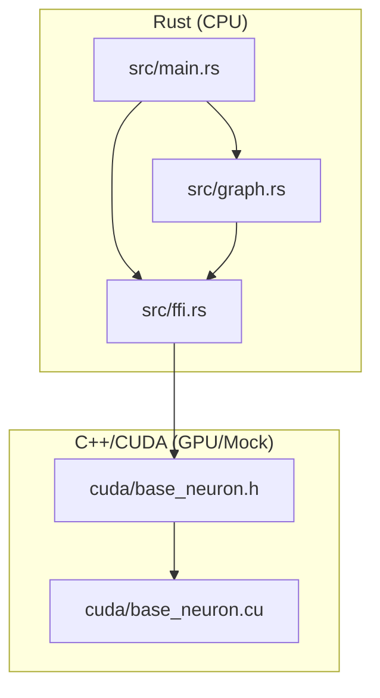

# Neuromorphic Engine: Project Architecture

This document describes the high-level project structure and interaction between components.

## Hybrid Stack Overview

The project is built on a hybrid architecture combining the safety of Rust with the performance of CUDA/C++.

- **Rust (Host/Orchestrator):** Manages the simulation lifecycle, owns the neuron and synapse graph, runs services (Astrocyte, Microglia), and handles visualization.
- **C++/CUDA (Device/Math):** Performs massive parallel computation of biological processes (metabolism, conduction, STDP) through Unified Memory.

## Component Structure

### 1. Orchestrator (Rust)
- `main.rs`: Entry point. Parses CLI arguments (`--benchmark`, `--stress-test`, `--dopamine-rush`), starts tick loops.
- `graph.rs`: `NetworkGraph` structure. Manages `BaseNeuron` and `Synapse` allocation in memory accessible to both sides (via FFI).
- `ffi.rs`: Bridge between Rust and C++. Describes data structures and functions called from Rust and executed on GPU/C++.

### 2. Biological Engine (CUDA/C++)
- `base_neuron.h`: Definition of neuron and synapse data structures. Must strictly match the Rust representation for correct FFI operation.
- `base_neuron.cu`: Kernel implementations.
    - `tick_neurons_kernel`: Metabolism, calcium, spikes.
    - `tick_synapses_kernel`: Neurotransmitter delivery, STDP, receptors.

## Memory Management

We use **Unified Memory**.
1. Rust allocates memory (or C++ calls `cudaMallocManaged` via FFI).
2. Pointers to neuron and synapse arrays are passed to CUDA kernels.
3. Rust can directly read `current_voltage` or other fields for charts without explicit `cudaMemcpy` (thanks to Unified Memory abstraction or CPU-based Mock implementation).

## Execution Flow (Tick Loop)

For each tick:
1. **Rust:** Updates inputs (e.g., sensors).
2. **CUDA:** Launches `launch_tick_neurons`.
    - First, all neurons are processed (in parallel).
    - Then, all synapses are processed (in parallel).
3. **Rust:** Runs "slow" biological services (every 10-100 ticks) — Astrocytes and Microglia.
4. **Rust:** Metric collection and rendering (if necessary).
