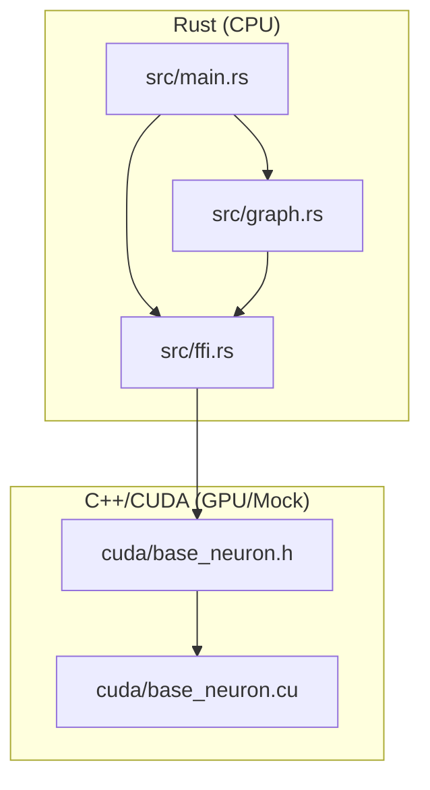

# Neuromorphic Engine: Project Architecture

Этот документ описывает высокоуровневую структуру проекта и взаимодействие между компонентами.

## Hybrid Stack Overview

Проект построен на гибридной архитектуре, сочетающей безопасность Rust и производительность CUDA/C++.

- **Rust (Host/Orchestrator):** Управляет жизненным циклом симуляции, владеет графом нейронов и синапсов, запускает сервисы (Astrocyte, Microglia) и обрабатывает визуализацию.
- **C++/CUDA (Device/Math):** Выполняет массивно-параллельные вычисления биологических процессов (метаболизм, проводимость, STDP) через унифицированную память (Unified Memory).

## Component Structure

### 1. Orchestrator (Rust)
- `main.rs`: Точка входа. Парсинг аргументов CLI (`--benchmark`, `--stress-test`, `--dopamine-rush`), запуск циклов тиков.
- `graph.rs`: Структура `NetworkGraph`. Управляет аллокацией `BaseNeuron` и `Synapse` в памяти, доступной обеим сторонам (через FFI).
- `ffi.rs`: Мост между Rust и C++. Описывает структуры и функции, которые вызываются из Rust и выполняются на GPU/C++.

### 2. Biological Engine (CUDA/C++)
- `base_neuron.h`: Определение структур данных нейрона и синапса. Должно строго совпадать с Rust-представлением для корректной работы FFI.
- `base_neuron.cu`: Реализация ядер (kernels). 
    - `tick_neurons_kernel`: Метаболизм, кальций, спайки.
    - `tick_synapses_kernel`: Доставка нейромедиаторов, STDP, рецепторы.

## Memory Management

Мы используем **Unified Memory**. 
1. Rust аллоцирует память (или C++ через FFI вызывает `cudaMallocManaged`).
2. Указатели на массивы нейронов и синапсов передаются в CUDA ядра.
3. Rust может напрямую читать `current_voltage` или другие поля для графиков без эксплицитного `cudaMemcpy` (благодаря абстракции Unified Memory или Mock-реализации на CPU).

## Execution Flow (Tick Loop)

Для каждого тика:
1. **Rust:** Обновляет инпуты (например, сенсоры).
2. **CUDA:** Запускает `launch_tick_neurons`.
    - Сначала обрабатываются все нейроны (параллельно).
    - Затем все синапсы (параллельно).
3. **Rust:** Запускает "медленные" биологические сервисы (раз в 10-100 тиков) — астроциты и микроглию.
4. **Rust:** Сбор метрик и рендеринг (если нужно).
