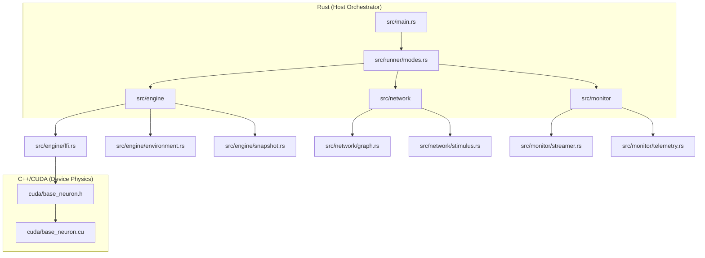

# Neuromorphic Engine: Project Architecture

This document describes the high-level project structure and interaction between components in the Neuromorphic Engine.

## Hybrid Stack Overview

The project is built on a hybrid architecture combining the safety, strict ownership, and asynchronous capabilities of Rust with the massive parallel performance of CUDA/C++.

- **Rust (Host/Orchestrator):** Manages the simulation lifecycle, parses configurations, regulates the environment (Homeostasis/Hypoxia), injects stimuli, and streams telemetry via WebSockets.
- **C++/CUDA (Device/Math):** Performs massive parallel computation of biological processes (metabolism, dendritic evaluations, STDP) through Unified Memory.

## Component Structure (Domain-Driven)

The system enforces a strict Domain-Driven architecture.

### 1. Engine (`src/engine/`)

- `ffi.rs`: The strict bridge between Rust and C++. It maps arrays directly to GPU kernels.
- `constants.rs`: Hardcoded engine limits, metabolic floors, and phase intervals.
- `environment.rs`: `EnvironmentRegulator` handles the biological feedback loop (hardware lag → hypoxia → metabolic depression).
- `snapshot.rs`: Complete binary serialization (`BrainSnapshot`) of topological and environmental state, enabling true persistence and resumption.

### 2. Network (`src/network/`)

- `graph.rs`: Core `NetworkGraph` structure containing neurons and synapses. Manages macro-level biological services (Neurogenesis, Microglia).
- `stimulus.rs`: Routes external stimuli (e.g., Bell vs Meat) and triggers global dopamine rushes based on Pavlovian logic.

### 3. Monitor (`src/monitor/`)

- `streamer.rs`: Tokio-based asynchronous WebSocket server pushing decoupled visual states to the UI.
- `telemetry.rs`: Captures and aggregates spike data, ATP profiles, and synaptic distributions.
- `visualization.rs`: Generates analytical charts via `plotters`.

### 4. Runner (`src/runner/`)

- `modes.rs`: Centralizes the execution loops (`run_simulation`, `run_benchmark_mode`, etc.), managing ticks, timers, and snapshot callbacks.

## Memory Management (Unified Memory)

The engine relies on **Unified Memory** (`cudaMallocManaged`):

1. Rust invokes device-side allocators through FFI to guarantee proper page-alignment.
2. Pointers to `BaseNeuron` and `Synapse` contiguous vectors are passed to CUDA kernels.
3. Memory is strictly optimized using sorting and coalescing (O(N^2) thrashing prevention).
4. Rust can directly read values (`current_voltage`, `energy_atp`) without explicitly calling `cudaMemcpy`.
5. RAII: `NetworkGraph` implements `Drop` to securely call `cudaDeviceSynchronize()` and `cudaFree()`, preventing segfaults and VRAM leaks.

## Execution Flow (Tick Loop)

For each single tick (1 tick = 1 ms biological time):

1. **Rust (Stimulus):** `StimulusService` injects forced voltages/dopamine into specific receptors.
2. **Rust (Homeostasis):** `EnvironmentRegulator` scales global ATP regeneration based on hardware latency.
3. **CUDA (Physics Kernels):** `launch_tick_neurons`
    - Processes neuron metabolism, leakages, and thermal noise.
    - Evaluates dendritic threshold conditions (HTM Predictive States & NMDA logic).
    - Processes synaptic delays, neurotransmitter buffers, and strict STDP causality.
4. **Rust (Macro-Biology):** Runs asynchronous/spaced services:
    - *Astrocytes* (Every 10 ticks)
    - *Microglia* (Every 500 ticks)
    - *Neurogenesis* (Every 1000 ticks)
5. **Rust (Monitor):** Pushes decoupled UDP/WebSocket telemetry packages to visualizer clients.
